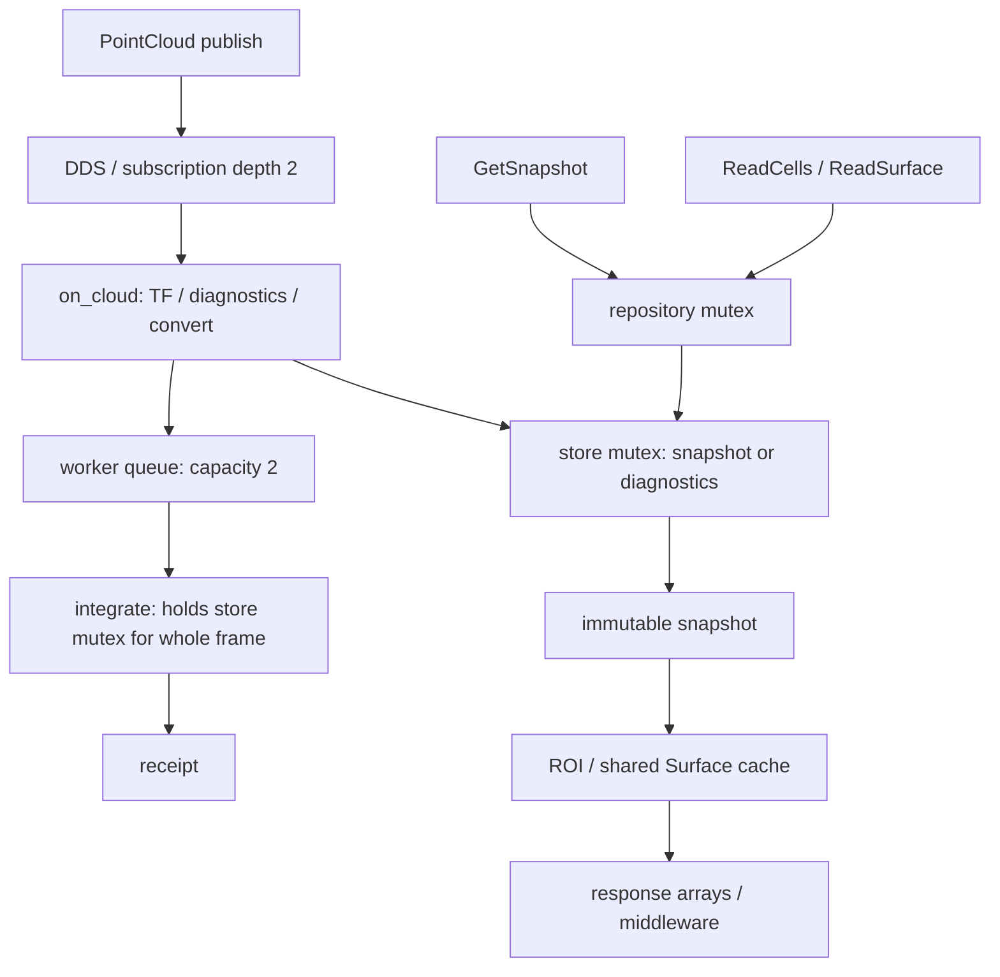

# 2026-10-30 -- O5–O7 接口全景与疑点审查

- role: reviews
- agent: codex
- model: gpt-6
- cli: codex
- status: done

## Summary

按用户要求先建立 whole picture，不确定修复项，不改产品、不重跑评分。审查固定产品 `4c8f1862ec357cb01616f4b04be636227461cf44` 的核心、ROS、worker、snapshot repository，以及工具工作树 `0142027624e5014c997bba0a31c6c14a53a7fdac` 的评测代码和历史原始数据。产品 src/include 与固定版本 diff 为空。

结论：O6 核心融合超时、O7 ROS 查询等待、过载观测缺口、恢复新鲜度时序是不同问题。存在可把多个 O7 症状联系起来的共享 store 锁，但没有事件级证据证明它解释了全部失败。原 O6/O7 FAIL 和正式 O5 not_evaluated 均不改变。

## 接口与计时边界

| 层 | 实际路径 | 当前计时/证明范围 |
|---|---|---|
| O5 代表证据 | profile CLI → `ObservationStore::integrate` → acquire/get → ROI → surface 两次 | 四个 fixture 的进程内代表覆盖；无 ROS；报告明确不是正式 O5 |
| O6 | 相同核心路径，144组变 seed 输入、每组 warm/cold | integrate_external 包含核心 Z 过滤、坐标变换、射线、融合、读视图维护；排除输入文件解析、ROS 点云解码/TF 查询、传输和队列 |
| O7 输入 | publish → DDS → `on_cloud` → TF → store diagnostics/convert → enqueue → worker → integrate → receipt | receipt.total_ms 只覆盖核心 integrate；queue_ms 从 enqueue 后到 worker 取出；发送到回执另计，不能由前两项代替 |
| O7 acquire | ROS GetSnapshot → repository mutex → store snapshot mutex → age/pressure → lease | ROS 客户端墙钟；与 O6 的内部 acquire 不是相同边界 |
| O7 ROI/Surface | ROS → repository.get → store diagnostics mutex → immutable snapshot → 组装数组 → ROS response | 包含取 handle 的 store 锁等待、内部读取、转换、传输和客户端调度；O6 的 get_handle_ms 单列，ROI/Surface 不含它 |
| release | repository mutex → erase | 产品幂等；O7 发出但不检查/保存返回结果 |
| health | worker 缓存 diagnostics → 500ms timer → YAML | 不直接取 store 锁；目前历史账本只保存接收时间，未持久化计数 payload |

调用关系：

图中的 store mutex 是同一把锁。worker queue 的计时起点在 input callback 可能等锁之后。

## 逐项疑点与证据等级

### A. 查询即使命中缓存，也会先等待写入锁

**源码确定**：`SnapshotRepository::get()` 持 repository mutex，随后 `store_.diagnostics()` 取 store mutex；`integrate()` 从验证到融合/收尾一直持该 store mutex。`get()` 在每次 ReadCells/ReadSurface 都执行。一个正在等 store 锁的 get 还会阻塞其它 repository acquire/get/release。未发现该路径上相反锁顺序的证据，不据此声称死锁。

**历史观测**：closeout D0/D1 同 revision、同列数，Surface 约20ms与113–150ms。这与读入口等写锁相容，但尚未量出该段等待。

**重要纠正**：进程 CPU 接近客户端墙钟，不能排除查询线程睡眠等锁，因为积分线程此时可能消耗进程 CPU。closeout 报告“不像纯睡眠等待”的表述只能描述整个进程，不能用于排除服务线程锁等待。

**缓存机制确定**：无 changed_keys 时 `with_identity()` 保留同一个 SurfaceCache；有 changed_keys 才重置 snapshot。相同 epoch/map_revision 的顺序读取在正常无 reset 路径上有明确共享缓存机制。“同 revision 反复重建”不是目前最有依据的解释。仍缺 cache identity/hit 与服务分段事件，不将源码推导当作本次命中实测。

### B. 入队之前的背压没有进入 queue_ms

**源码确定**：`on_cloud()` 为取得 epoch 调用 `store_->diagnostics()`；随后才 enqueue。input callback 是 MutuallyExclusive，subscriber depth=2，worker 等待队列也为2。一次回调等积分锁时，后续回调不能并行进入；积压可以发生在 worker 队列之前。

**历史观测**：过载523条已观测回执的 queue_ms 仅0.005521–0.040398ms；600条发送里77条无回执。低 worker queue age 不能证明没有上游积压。当前没有逐 ID callback entry/accept/completion/send-receipt 证据，不能确定77条发生在 DDS、入口、执行还是回执接收处，也不能把 reliable QoS 当成端到端业务确认。

**额外核账边界**：QUEUE_FULL 同时增加 worker.queue_rejected 与 adapter_rejected，不能求和当两次拒绝。worker 捕获普通异常的 INTERNAL_ERROR 分支未回填原 observation 身份，属于未触发的关联风险，不是这77条的已证根因。service 输入模式异常通过服务 response 返回，subscription 异常发 topic receipt，两个路径不应混用核账规则。

### C. 恢复 STALE 是失败结果，但未证实为产品恢复缺陷

**源码确定**：GetSnapshot age = 查询 now − snapshot.last_integrated_stamp；max_age=2000ms，allow_stale=false。恢复发送线程与第一次 acquire 都从 phase 的 t=0 开始；没有“首个恢复输入完成后再首查”的约束。排空使用客户端所有 pending ID，77个无回执会使其等满30秒；不等同于 worker 一直有积压。

**原账本复算**：最后过载回执至恢复首查29.674s；恢复首帧 actual-send 至首查5.093ms；首个恢复完成回执在首查开始后125.355ms到达。此时旧 snapshot 超过2s新鲜度是有力解释，但没有服务线性化点和失败响应 age，不能认定精确竞态已经被实测定位。

现行合同要求恢复请求正常完成，所以仍 FAIL。应先明确恢复首查应验证“立即可读新数据”还是“写入恢复完成后的可读性”，不能现在自行放宽 age、延后首查并覆盖旧成绩。

### D. O6 唯一失败独立存在，不由 ROS 锁竞争解释

**原始样本复算**：`r01_b00_cuboid_c30000_o50_x50`，30个评分样本，integrate_external P95=517.297808ms。全部30帧 changed_keys>0。receipt 分段中位数：preprocessing 12.975ms、preparation 74.716ms、fusion 294.051ms；fusion max435.401ms。分段中位数不相加当总中位数。

这是串行进程内调用，没有 O7 并发 ROS 查询；故共享锁解释不能用来消掉这项失败。当前证据将主要成本指向 fusion 聚合段，但该段包含多个操作；历史其它 fixture 的 ApplyBatch 归因不能直接移植到这一组。需独立检查该组融合内部，而不是先选一个优化模块。

### E. 查询内容、释放、终态及压力覆盖不足

O7 `_query_chain()` 检查 acquire/ROI/Surface status、Surface.done 和完整 snapshot identity；没有验证返回数组长度/ROI.done/next_cursor 或内容 oracle/digest。`release` 在 finally 发出，但结果被忽略，查询可以在释放超时/错误时仍记 OK。acquire 超时后未来才成功的 handle 没有清理路径，最多由5s TTL回收；该分支未在本次失败中证实发生。

查询链顺序执行，只有发送线程独立。若一条查询超过1秒，下一条会晚发；没有每条 query 的 planned timestamp/完成 timestamp 字段供完整调度审计。客户端调用以2ms轮询 future，因此极短 RPC 也带客户端取样成本。

5s TTL、最多8 handles/2 revisions、release、过期和压力必须与原 O3 覆盖区分；O7单条串行链不能证明所有并发 handle 边界。

### F. Health、过载覆盖与判官证明范围

历史 runner 用 health_times 检查含端点的接收间隔；但只在内存保留 latest health，最终 ledger 不包含逐条计数，也不保留精确 score_start/end。closeout_g2 的 `judge_normal_window()` 没有重新执行 health gate 或满120秒调度检查；其“只有Surface失败”不能读作对其它全部合同项的独立复证。

过载覆盖谓词把任意 queue_ms>0 或 health.in_flight>0 当作已观测过载。微秒级正常交接和单个 in-flight 本来就可能存在，因此这个谓词不能区分正常运行与真正积压。当前过载已经因核账/恢复失败，不改变评分，但不能额外宣称充分验证了队列饱和和显式拒绝路径。

### G. O5、O6与O7负载/首查不是相同语义

正式 O5 来自 `d7af0b70...:docs/plans/OCC_OCTOMAP_OBSERVER_G1_20261026.md` O5行；当前 ApplyBatch报告只提供代表fixture覆盖，明确不替代正式O5。其四fixture进程内正确性摘要一致，不证明 subscription、ROS查询、释放和新鲜度语义。

O6轮换输入；O7 `ensure_points()` 只生成一帧，随后重复点集、更换stamp。O7同 revision 饱和阶段与O6不断更新的成本不可作速度比。O6 first_call 是每帧后第一次调用，不自动等于缓存未命中；首建、变化后重建、同revision首读应根据身份区分。Off没有 cache_hit字段。此次失败组全30帧发生变更，但不据此推断全144组都具有同样的重建覆盖。

O6/O7 ROI 实际都是从[0,0,0]读16³网格；原O5还描述了物理ROI范围，应在正式O5资格核对中说明映射，不能用固定4096数目代替全部几何语义。Surface读全列，最大分页65536；当前诊断29353列可单页，不能外推到更大几何。

### H. 资源是另一项观测缺口

RSS通过不等于读视图/缓存512MiB门通过。snapshot block共享、当前view与pin视图、SurfaceCache需避免重复归属计数；现有接口没有足够统计。该项保持not_evaluated，不临时推导一个RSS比例。

## 尚待确认的最小问题集（不是修复清单）

1. Surface：请求进入、repository等待、store等待、surface缓存/构建、响应数组组装、服务线程CPU分别占多少？当前同revision的时延是否主要发生在取handle之前？
2. 过载：77条中的首个缺口在哪个边界？发送、callback-entry、enqueue、完成、回执发布、客户端接收必须按同一ID连接；保存health原文计数及每阶段截止快照。
3. 恢复：首个新输入的完成与首查线性化的真实先后如何？新鲜度判断是否按合同正常拒绝旧数据？
4. 核心：O6失败组的fusion内部成本是什么？不得用O7锁问题替代调查。
5. 证明完整性：查询内容/释放终态、真实调度与health门、重建类别、资源归属及正式O5覆盖还有哪些可从旧证据补齐，哪些必须新增非计分取证？

上述边界澄清后才选择产品修复、工具修复或合同澄清。任何新增插桩实验应单独标not_scored，先冻结取证范围和扰动检查，不重跑144组碰运气。

## Verification

只读原始证据复算与源码审查，无新ROS/仿真/评分进程。可复现命令：`python3 docs/status/evidence/occ_o5_o7_interface_audit_20261030/run01/audit.py`。输出含输入及审查源码SHA256；确认产品源未改、144组唯一、116+28来源、517.297808ms失败及过载/恢复时间差。未进行完整144组所有原始门重算，未动态测量锁等待；不声称最终根因已全部定位。

## Pointers

- `docs/status/evidence/occ_o5_o7_interface_audit_20261030/run01/AUDIT.json`
- `docs/status/evidence/occ_o5_o7_interface_audit_20261030/run01/audit.py`
- `docs/status/evidence/occ_o6_o7_20261029/closeout_g2/FINAL_REPORT.md`
- `docs/status/evidence/occ_o6_o7_20261029/run03/o7/overload/ledger.json`
- `docs/status/evidence/occ_owner_b1/occ_apply_evaluation_20261029/run01/FINAL_REPORT.md`
- `/tmp/elfin-occ-octomap-perf-cursor-g1/src/uld_occ_observer/src/observer_node.cpp:67`
- `/tmp/elfin-occ-octomap-perf-cursor-g1/src/uld_occ_observer/src/snapshot_repository.cpp:13`
- `/tmp/elfin-occ-octomap-perf-cursor-g1/src/uld_occ_observer/src/observer.cpp:56`
- `/tmp/elfin-occ-octomap-perf-cursor-g1/src/uld_occ_observer/src/profile_cli.cpp:78`
- `/tmp/elfin-occ-octomap-perf-cursor-g1/src/uld_occ_observer/test/benchmark/sustained_run.py:290`
- `/tmp/elfin-occ-octomap-perf-cursor-g1/src/uld_occ_observer/test/benchmark/closeout_g2.py:413`
