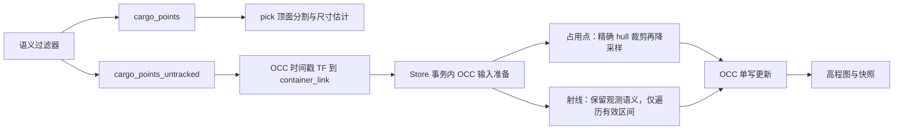

# OCC 容器内裁剪与处理提速计划

- owner: eng/codex/gpt-6
- base_revision: 865658127f92f28ed9d4bba617eb9b476405fb44
- status: proposed
- scope: OCC 消费分支；保持 pick 顶面分割输入、算法、参数与输出契约。

## 1. 目标与已确认事实

目标：在 OCC 更新前剔除与容器占用无关的点，减少降采样、点到体素转换和无效射线步进；保持容器内真实观测及自由空间语义。提速是待测目标，不能从点数下降直接推断总耗时下降。

当前默认路由：semantic_point_filter_node 分别发布 `/luggage/semantic/cargo_points` 和 `/luggage/semantic/cargo_points_untracked`。luggage_detector_node 的 cargo_cloud_topic 默认订阅前者；cargo_volume_mapper_node 默认订阅后者。mapper node 在采集时间做 TF 到 container_link，再过滤 floor+5cm 以下点。apply_integrate 随后 finite-filter/downsample；mapper 用 AABB 与按体素中心计算的 hull active mask 限定写入。

因此已有地图存储边界，但缺少降采样前的逐点精确 hull 裁剪。旧 `_raycast_indices` 沿相机至端点全长以 resolution/2 步进，循环中才过滤容器外格。ULD 为带斜面的内轮廓；仅长方体 ROI 不足以精确排除斜面外点。

## 2. 隔离 pick 的硬约束

裁剪仅在 OCC 消费端进行，不移动到 semantic_point_filter_node，不改其两个发布 topic 的内容，不改 suitcase tracker、luggage_detector_node、顶面分割、吸盘候选、尺寸估计及 attachment。

同一消息到不同订阅者必须保持独立：不得原地改 PointCloud2.data、共享 numpy buffer 或帧缓存。裁剪返回只属于本次地图事务的数组/索引；输入写保护测试必须通过。禁止用 OCC 内轮廓裁掉位于 ULD 外的待抓箱子。

实现前记录实际 launch 参数解析后的 topic，而非只依据默认值。如果配置重映射到同一 topic，OCC 本地消费副本仍必须隔离；不新增一个替代公共 cargo_points 的裁剪 topic。



## 3. 单一边界来源与接口

唯一几何来源继续是 normalized container descriptor + geometry_hash，来自 scene_tf_config 中的容器内尺寸、floor、ceiling、chamfer。不得新增另一组 crop_length/width/height 或隐藏毫米裕量。使用现有 EPS；坐标统一 container_link，不在 camera/world 轴上直接套 ULD 长宽高。保持现有水平容器适用限制。

计划新增/调整接口：

| 所在模块 | 接口 | 契约 |
|---|---|---|
| description/container_geometry.py | `contains_points(hull, points_container)` | 批量逐点 mask，与标量 contains_point 在 EPS 边界内一致；不改输入。若避免扩展核心文件，则独立 batch 模块导入核心，不能复制斜面参数来源。 |
| description 几何批量模块 | `segment_hull_intervals(hull, origins, ends)` | 返回线段 t∈[0,1] 的交叠区间和相交 mask；只算几何，不决定传感器证据是否有效。平行、相切、零长度显式处理。 |
| perception/cargo_occ_input.py（新增） | `prepare_occ_observation(points_container, origin_container, hull, resolution, policy)` | 返回只读 PreparedOccObservation：hit_points、独立 ray 输入/来源索引、计数；不写地图，不改公共点云。 |
| perception/cargo_view_integration.py | `apply_integrate(...)` 内调用统一准备接口 | finite→现有高度过滤策略→占用点 hull crop→hit downsample；射线走独立语义路径；observed_points 仅返回被允许用于本次 OCC 确认的观测。 |
| perception/cargo_volume_mapper.py | 显式 hit/ray 分离的内部集成入口 | 不再隐式让同一个裁剪后数组兼任 hit 和 ray 端点；地图写入仍归 Store。旧直接算法测试入口可作为窄适配层委托统一逻辑。 |
| perception/occupancy_map_store.py | 现有 `apply_update` | 仍为唯一生产写入口；几何身份、快照、时间、幂等检查通过后才做准备及更新。 |

PreparedOccObservation 冻结字段，numpy 数组设只读或独立所有权。计数至少有 raw、finite、height_kept、inside_aabb、inside_hull、hit_downsampled、ray_candidates、ray_intersecting、rays_selected、samples_visited。统计使用分开的阶段计数，避免同一个 n_kept 在不同函数反复覆盖。现有 n_kept 保持兼容含义，新计数单独输出。

node 保留时间戳 TF、请求 admission 和发布职责。原 floor+5cm 过滤迁至 OCC 输入准备接口时，阈值与生效通道不变；node 不再重复执行。该阈值是已有观测策略，不是 container floor，不能混为新 ROI 下边界。

## 4. 占用点与射线必须分别处理

### 4.1 占用点

先在 container_link 精确测试点是否位于 hull 内，再降采样，防止外点与内点同属一个边缘网格时代表点污染。AABB 可向量化粗筛，斜面做精筛；最终以统一 hull 判定为准。保留 mapper 的 active mask 作为最后写边界，不能因为前面做了裁剪就删除防线。

不改几何 committed box 的栅格化，不改 unknown/free 定义，不插值补洞。相较旧逻辑，斜面外但落入 active cell 的点可能不再产生 hit，这是明确的边界修正，必须逐例列出差异而非声称全部旧输出逐位一致。

### 4.2 射线

不能把 hull 外端点全部删除后再做 raycast：外端点可能形成内部自由空间证据。保存独立 ray 端点流与原始索引。

第一版优化保持旧语义：保留原 ray 下采样预算、顺序和选择相位，计算所选线段进入/离开网格 AABB 的区间，仅访问这一区间内原来的采样位置。使用旧 steps 与原始 t=k/steps，禁止改成从裁剪后起点重新等距采样，否则可能改变 miss 格集合。无交叠 ray 直接跳过。对 active mask 每格检查仍保留。

精确 hull 区间用于分类与后续安全优化；射线步进的首版跳过范围采用保守网格 AABB，是因为旧语义是“采样点落入 active voxel”，在斜面边界与“采样点精确在 hull 内”不同。若进一步收紧到 hull，必须用独立 oracle 证明不丢合法边缘采样，不能为了速度扩大 free 集合。

专用 container_depth_observer/depth_view_rays 通道继续使用既有 aperture entry、closed-face、terminal-band 和物理首命中限制；几何相交不代表观测合法。不启用当前未启用的通道，不把旧 semantic ray 语义偷偷替换成另一套。公共 ray 步进优化需要同时验证两个通道。

保持预算候选选择再做区间跳过，首版不将跳过后的预算补给其他 ray；否则证据和运行时间比较同时改变采样策略。后续若要提高覆盖率，另设任务。

## 5. 修改位置与执行顺序

1. **基线/仪表**：新增只读阶段计时与计数、回放工具 `scripts/g3/compare_occ_crop.py`，保存旧版本原始输入、TF、descriptor、结果及性能。核实部署路由。先完成输出可回放检查，再测量。
2. **几何接口**：批量点判定与线段区间；标量 oracle、EPS、斜面及退化边界测试。
3. **OCC 输入模块**：新 cargo_occ_input，hit/ray 数据分离；只在 Store 调用链接入；移除 node 重复高度过滤。
4. **射线区间优化**：保留原采样相位、预算、端点语义；比较命中/miss index set、log odds、sensor shadow 和 geometry lock。
5. **pick 隔离与集成回放**：同时投喂同一帧到 pick/OCC，证明 pick 消息及结果不变；OCC 行为和性能离线验收。
6. **冻结、构建、安装验证**：同次提交测试/最近架构文档；hash 验证安装，记录实际参数；不以本轮计划自动启动完整装箱。

预计涉及：description 几何接口；perception cargo_occ_input、cargo_view_integration、cargo_volume_mapper、mapper node、必要 Store 接线；对应 test 文件；cargo_grid/container_geometry 架构文档与回放脚本。semantic_point_filter_node、detector/top 算法不在行为修改范围。

## 6. 决策完整的验收矩阵

### A. 几何及地图行为

分辨率 1/2/5 cm；cuboid 与当前七面 hull；容器 yaw 0/37/90°；用固定 seed=20261023。每种组合包含：全内、全外、混合、斜面外、六面及斜面上的点、边界±EPS/±2EPS、空数组、NaN/Inf。每组固定 10,000 点加显式边界点，每组一次确定性检查；全部通过（ALL），不是成功率估计。

批量 mask 与标量 oracle 不一致=0；输入数组修改=0；有效 active hull 外新增占用=0；坏 TF/geometry hash 不一致必须拒绝且 map identity 不变。几何锁、sensor shadow、snapshot export、surface 现有测试全部通过。

射线矩阵：源在外/内、端点在前方/内部/后壁外、平行/相切/零长、仅穿斜面缺口、开口进入、封闭面进入、terminal band 两侧；每种分辨率固定 10,000 个随机加显式边界 ray。优化前后同策略 miss index set 不一致=0、log odds 不一致=0；专用 depth 通道不得新增穿墙 free。hit 差异只允许独立 oracle 判明的旧边缘外点污染消除与 crop-before-downsample 的合法代表点变化，其他差异=0。修正后结果必须与“标量精确裁剪 + 相同降采样/射线策略”的参考链逐格一致。

对前次五箱测量 fixture，原几何提交图应逐位不变；2 cm 缝与所有旧 72 例 oracle 仍通过。新增未知格不得解释成 free；不会填补采样不足造成的空点。

### B. pick 隔离

两个固定场景：待抓箱子完全在 ULD 外、点云跨 ULD 边界；固定十帧/场景及其图像/掩码/检测配置。旧/新对同帧回放：pick 输入消息 data hash、frame_id、stamp、点顺序全部相等；确定性顶面分割 mask/inlier index 完全相等，顶面中心、法向、尺寸和吸盘候选误差≤1e-9（先固定算法 seed/线程）。同时验证 OCC 的输入处理不会修改公共缓存。

若算法仍有并行非确定性，先锁定确定性 replay profile再评分，不能事后放宽容差。没有可回放原始数据时，合成消息隔离门可通过，但真实 pick 回放明确 `not_evaluated`；完整隔离验收不能记 pass。需在不动机械臂的非评分采集阶段补齐数据，必要的仿真采集按唯一 Gazebo 栈规则排队。

### C. 性能

同机、同解释器/依赖、同 descriptor、同分辨率与 max_raycast_points=2000。建立可复现矩阵：每帧 10k/100k 点，端点 hull 外比例 0/50/90%，每种额外设置“外点射线全不相交”和“外点穿过内部”两类；分别测 1/2/5 cm。全内两种外点条件合并。真实录制帧至少 10 帧作为独立组，不能用合成代替。

每个 workload 预热5次、测量30次；baseline/new 交替顺序，禁止并行跑计时或 cProfile。每次同地图初始状态，reset 在计时外。采集 decode、TF、prepare/crop、downsample、ray、store/snapshot 及总时间、RSS；采集一次服务调用墙钟总耗时，不把阶段耗时之和代替实际墙钟。

- 所有行为门先通过；未达30样本则该组 `not_evaluated`。
- 目标组：100k 点、90% 外点且不相交、1 cm，总处理 P95≤基线的80%，峰值 RSS≤基线的110%且<2GiB。
- 防退化：其余合成组各自总时间 P95≤基线110% + 1ms；真实10帧每帧各30样本同门。要求每组单独过，不用总体平均掩盖退化。
- 点数门：目标组 hit 几何判定后点数等于 oracle 的10k；无相交 ray 的步进次数=0。帧内计数须守恒且有拒绝分类。
- 记录 baseline/new 每组 P50/P95/max、成对差值；未达提速门只报告功能结果，不宣称性能目标完成。若边界过严/过松需要修改，必须在新 generation 冻结后重测，不能评分中改门。

这是确定性正确性门和固定负载延迟门，不是装箱成功率门，不把30次全部通过解释为可靠性百分比。上述门可区分“未提速”与目标20%改善，并允许1ms计时固定开销；实际收益主要受外点数量、相机距离、射线交叠比例和地图快照耗时占比影响。

## 7. 命令与证据

待实现脚本约定提供以下命令；此处是执行契约，尚非现成可运行脚本：

```bash
python3 scripts/g3/compare_occ_crop.py capture --revision 86565812 --profile config.json --out <baseline>
python3 scripts/g3/compare_occ_crop.py correctness --baseline <baseline> --seed 20261023 --out <correctness>
python3 scripts/g3/compare_occ_crop.py pick-isolation --frames <frozen-frames> --baseline <baseline> --out <pick>
python3 scripts/g3/compare_occ_crop.py benchmark --baseline <baseline> --warmup 5 --repeat 30 --out <timings>
python3 -m pytest -q --confcutdir=. src/luggage_description/test/test_container_crop.py
python3 -m pytest -q --confcutdir=. src/luggage_perception/test/test_cargo_occ_input.py src/luggage_perception/test/test_occ_crop_isolation.py src/luggage_perception/test/test_depth_view_rays.py
```

还须运行已有 mapper/store/grid/snapshot 测试及原72例脚本；验收列表写入 manifest，不能仅“相关测试通过”。capture/评分必须记录确切 commit、dirty清单、源文件hash、环境、所有参数、输入hash、seed。baseline和candidate都为冻结clean源码；仪表先在非评分预演验证后冻结，同一评分期间不改被测产物。

证据根 `docs/status/evidence/occ_owner_b1/occ_container_crop_<run>/`。

| 边界 | T1 | 失败触发与 T2 | 窗口/格式/预算 | 回放 |
|---|---|---|---|---|
| 公共点云→pick/OCC | topic/frame/stamp/hash、计数 | 共享数据被改、pick输出不一致：同帧两支输入、图像/掩码、结果 | 当前失败帧及前后各1帧；NPZ/JSON/必要图像；每例≤128MiB | pick-isolation |
| TF→crop→downsample | TF/geometry hash、各阶段计数/耗时 | mask或代表点差异：输入、mask、source indices | 单失败帧；NPZ/JSON；≤64MiB | correctness |
| ray→voxel→surface | ray数、步数、map身份、diff数 | 新free/丢hit/投影差异：所选ray、旧/新索引、状态和shadow | 单失败帧及对应初始地图；压缩NPZ；≤128MiB | correctness |
| 总体性能 | 每帧全部样本、RSS、阶段时间 | 性能门失败：固定输入和profile；后续独立cProfile不混入分数 | 当前workload；JSON/NPZ；≤128MiB | benchmark |

单次总≤2GiB，失败原始输入不得覆盖；达容量上限停止采集并标 incomplete，而非丢证据续跑。采集前测试写入、读取、解码、hash及回放；正常帧只保存可复用输入和轻量指标，失败才保存全量差异。记录 capture_complete/replay_possible/missing；缺少必需输入不得 pass。时间性能组采用相同轻量仪表，额外dump IO不纳入计时；保留带仪表的真实阶段耗时。

## 8. 交付与明确适用范围

交付统一输入准备模块、几何批量接口、hit/ray 分离、可观测统计、单元测试、pick隔离证据、正确性与性能对比报告、安装hash验证和最近文档更新。代码、测试和契约一同提交。

本计划不修改感知尺寸、不修改保守包络、不改 placement cost、不改变已提交实体、不启用新深度通道、不安排运动或完整装箱评分。裁剪只减少无关数据处理；无法解决容器内部点云稀疏导致的 unknown，也无法保证所有负载都有明显提速。
