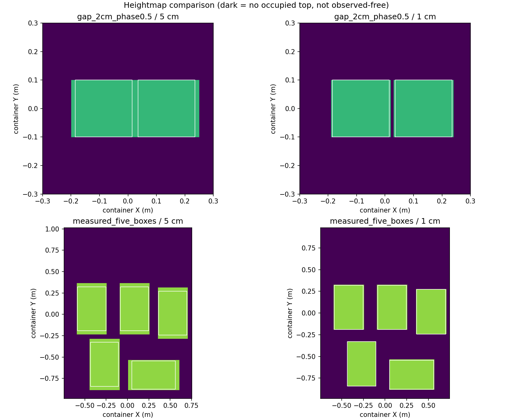

# S1：1 cm OCC / 高程图开发与 5 cm 对比

- code_revision: 6e6a828e20af2fbf207802cba0c2379744d35752
- baseline_revision: fc7c704b
- plan_revision: e5799754
- result: pass
- scope: 离线地图开发、单元测试、安装节点验证；完整装箱与布局 cost 属于后续阶段。

## 实现与统一权限

统一默认参数为 `src/luggage_description/config/cargo_grid.yaml` 的 `resolution_m: 0.01`。OCC XYZ、高程图 XY、floor prior 共用此来源；通过 launch 的 `cargo_map_resolution_m` 启动覆盖。共享配置放在 description，避免 planning 反向依赖 perception。参数启动后只读，改变分辨率需要重启、新地图 epoch。地图内容继续只由 `OccupancyMapStore.apply_update` 写入，投影为读副本。没有更改 attachment 包络或重复叠加尺寸裕量。

冻结网格规格、紧凑数组和纯投影模块使 1 cm 地图可用；统一 allocation/export/consumer 上限为 8M voxels。部署参数范围 0.005–0.05 m，超界/非有限值/超预算在分配前拒绝。规划私有障碍数量上限保持原值；本次通过地图导出与 consumer 读取测试，不代表开启 prior 后任意场景均可展开为私有障碍。

## 测试与比较结论

- 136 项地图测试 + 87 子测试、39 项 consumer/launch 测试全部通过（共 175 项 + 87 子测试）。详见 `unit_grid_final.log`、`unit_consumers_final.log`。
- 5 个相关 ROS 包构建通过；S1 与集成 worktree 均验证 13 个源码/安装文件 hash 一致。
- 实际安装 mapper 节点在独立 domain 37 启动默认 1 cm、覆盖 2 cm / 5 cm；体积、高程、节点参数一致。运行时改成 3 cm 被拒绝且地图身份不变，节点随后关闭。
- 72 个确定性 oracle 对比全部通过：yaw 0/5/45/90° × 四种固定世界位移、2 cm 缝 × 四种位移、三种非整厘米厚度、测量五箱布局，均比较 5/2/1 cm。对 active 区内正体积交叠的独立几何 oracle：漏占用、额外占用、最高占用投影不一致、active mask 不一致均为零。
- 新实现的 5 cm states、active mask、surface 与修改前保存的 5 cm 基线逐项相等。
- 2 cm 缝：5 cm 网格四种相位均没有保留清晰空列；1 cm 保留 1–2 列（20 cm 长缝中的 20–40 个格）。边缘格仍按正交叠保守占用。此统计为格中心覆盖，不是物理缝隙面积测量。
- 三种厚度 20.3 / 21.75 / 22.9 cm 的顶面量化误差：5 cm 为 47 / 32.5 / 21 mm；1 cm 为 7 / 2.5 / 1 mm。
- 五箱测量布局占用投影面积：5 cm 1.0500 m²，1 cm 0.8996 m²；保守栅格外扩减少。该例最大顶高误差两者同为 5.76 mm，实际误差受网格对齐影响，不保证每例严格下降。

## 是否有空点

**已提交箱体内部未发现栅格化空洞；稀疏传感器输入有未观测格。**

传感器采样诊断对同一 20×20 cm 箱顶只送入 16 个间距 5 cm 的点：5 cm 网格占 16/16 格，1 cm 占 16/400 格，剩余 384 格 unknown。送入 400 个间距 1 cm 的点后，1 cm 占 400/400，unknown 为零。这是受控采样实验，不是当前相机实际密度测量。没有自动把 unknown 填为 occupied/free；不能把“已知实体无孔洞”推广为“真实点云无空点”。

五箱输入由历史 placement request 中的测量 ledger 重建，不使用物理真值。这是 derived fixture，缺少原始传感器帧及原场景传感器 free 列，不能宣称复现了原始全场地图。图中的深色表示无 occupied 顶面，可能是 unknown/inactive，不等于已观测 free。



## 性能

实尺寸 1.49×1.97×1.48 m，同机每组 3 次预热、30 次测量；五次箱体提交含 surface/digest，reset 不计时。RSS 是单进程累计峰值。

| 分辨率 | voxels | 构建及首 snapshot | 五次提交 P95 | RSS |
|---|---:|---:|---:|---:|
| 5 cm | 36,000 | 0.012 s | 0.009 s | 40.0 MiB |
| 2 cm | 549,450 | 0.050 s | 0.060 s | 91.3 MiB |
| 1 cm | 4,344,244 | 0.331 s | 0.288 s | 385.7 MiB |

三组均满足构建≤30 s、五次提交 P95≤1 s / max≤2 s、RSS<2 GiB，且样本数均≥30。此门是资源/延迟门，不是装箱成功率门。72 例是确定性 ALL gate，不作概率外推。此前 cProfile 数据有 profiler 开销，不用于声称加速倍数。

## 复现

在 `/tmp/elfin-grid-1cm-g1`、上述冻结版本和干净源码下，先 source `/opt/ros/humble/setup.bash` 与该 worktree `install/setup.bash`。证据根设为 `E=docs/status/evidence/occ_owner_b1/grid_1cm_s1_20261023`，新输出路径避免覆盖证据。

```bash
python3 scripts/g3/compare_cargo_grid.py --out /tmp/grid_compare_replay --measured-case "$E/measured_five_boxes.json" --baseline "$E/baseline"
python3 scripts/g3/benchmark_cargo_grid.py --out /tmp/grid_benchmark_replay --case "$E/measured_five_boxes.json" --repeat 30
colcon build --packages-select luggage_description luggage_perception luggage_packing luggage_planning luggage_gazebo
python3 scripts/g3/check_cargo_grid_install.py --workspace "$PWD" --out /tmp/grid_install_replay
```

启动配置接口（本轮未启动 Gazebo）：

```bash
ros2 launch luggage_gazebo sim_world.launch.py cargo_map_resolution_m:=0.01
# 对照切回 5 cm：cargo_map_resolution_m:=0.05
```

## 诊断与证据索引

初始未 source ROS 导致 rclpy 导入失败；补齐环境后重跑。原 frame migration 测试的输入变换后完全位于容器外，在旧版本已复现失败；修正 fixture 为容器内，保留正负坐标变换断言。首次 comparison 工具错用 COMMITTED 状态字符串，修正为实际 accepted；首次 hardware launch 测试手工上下文缺少新参数，补空默认及参数覆盖测试。失败日志原样保留，随后最终测试全部通过。

- `comparison_height/summary.json`：最终 72 例；各子目录包含输入、NPZ oracle/actual/active/height、surface 和 result。
- `baseline/`：修改前 5 cm 输出、hash/版本、性能 profile 与原测试失败复现。
- `benchmark_final/`：冻结版本 30 样本每组及六组采样输入/输出。
- `integration_build.log`、`integration_install/installed_runtime.json`：实际集成 worktree 安装验证。
- `run_manifest.json`、`SHA256SUMS`：版本、范围与完整证据文件校验。全量证据保存在 primary 与两个 worktree，Git 保存报告、汇总、关键日志、输入、图和全量 hash 清单。
