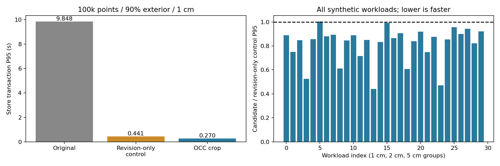
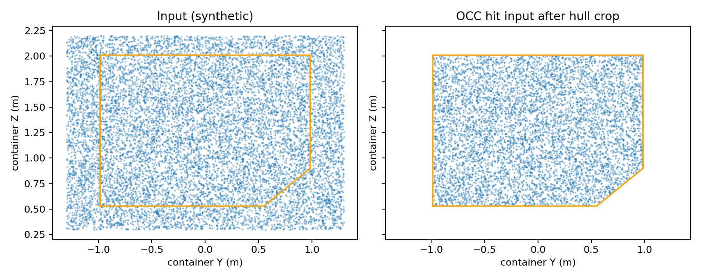

# OCC 点云预处理实现与效果验证

- implementation_revision: 9efed002
- benchmark_revision: b7ac4371
- original_baseline: 86565812
- plan: e6a5b19f；G2 因果性能对照细化在 9efed002
- functional_offline: passed
- complete_deployment_replay: not_evaluated

## 修改结果

裁剪只在 OCC 消费路径执行，原始语义点云、pick 顶面分割与 attachment 不变。时间戳 TF 后，Store 的唯一写路径调用 cargo_occ_input：有限点/原高度策略过滤→按唯一 ULD hull 裁剪→占用点降采样。height 策略从 node 移至统一接口，MapUpdate.minimum_z 纳入操作幂等指纹。几何批量接口与标量内轮廓一致，包含斜面。

射线与 hit 保留独立输入，原始未裁剪的 ray downsample 顺序/预算不变；AABB 区间跳过保持原 t=k/steps 和 active mask 判定。完全不相交的射线零步进；外端点仍可提供内部自由空间证据。专用深度通道的墙面和 terminal band 规则未改变。输出统计在 Store details 和节点 OCC_PREPROCESS 日志可见。

两处只为读 revision 而执行全图 frontier stats 的旧调用已改为直接读 map_revision；节点积分响应也使用不枚举 frontier 的 occupancy_summary。full stats 接口保留原语义。

## 功能验证

- 244 项单元测试 +87 子测试通过。覆盖批量几何 oracle、裁剪优先于降采样、不同 yaw、有限值拒绝、原输入不可改、幂等策略身份、geometry hash、summary不扫描frontier、Store/锁/shadow/投影等。
- 20 帧合成双分支测试：箱体全在 ULD 外及跨 ULD 边界，各10帧；生产顶面算法前后输出所有字段和 plane_labels 一致，PointCloud2 data/frame/stamp/顺序不变；新增吸盘候选所有字段（除耗时）也一致，见 unit_suction_isolation.log。不是实测相机帧，不宣称实际感知成功率。
- 实际 ROS IntegrateCargoView 服务测试 12 pass / 4 原有 parked skip；见 unit_service.log。包含无效请求、TF、观测积分等行为，无 Gazebo/机械臂运动。
- 原72组 1/2/5 cm 网格几何回归通过，五箱测量 fixture 与旧5cm基线一致。
- 随机射线每种分辨率10,000条，初次30,000条与旧实现 miss 集合差异0；补充 yaw 与状态检查见 supplemental_oracle.json。
- 新工作树安装源码hash一致；实际安装节点 frame=container_link，topic=/luggage/semantic/cargo_points_untracked，resolution=0.01，原 floor+5cm 策略生效。

## 性能结果与归因

计时是单进程 Store apply_update 墙钟（含指纹、积分、快照），不是 ROS 网络服务端到端延迟。每组5预热+30测量，旧新交替顺序；reset在计时外，固定输入/seed/版本，禁止并行性能任务。完整30组对照使用“旧版仅将两次stats读revision改为直接读revision”的显式控制组，以隔离裁剪收益。原版完整逻辑另对目标负载测30次。

目标负载100k点，90%外点且不相交，1cm：

- 原版 P95：9.8482 s；候选 P95：0.2670 s（原版对照运行）。
- revision-only 控制组 P95：0.4415 s；候选 P95：0.2700 s；预处理单独下降 38.9%。
- 已完成矩阵：30组，30组过门。各组阈值与完整样本在JSON，不能用总体平均遮掩单组失败。

旧 profiler 显示 stats/frontier 扫描主导原耗时，profile带额外开销，仅用于定位，未混入计时分数。共享进程峰值不是独立 variant RSS 比率；隔离进程 RSS 探针另列于 rss.json。

| 工作负载 | 控制组P95秒 | 候选P95秒 | 比率 | 结果 |
|---|---:|---:|---:|---|
| n10000_out0_cross0_r0.01 | 0.8029 | 0.7140 | 0.889 | pass |
| n10000_out0.5_cross0_r0.01 | 0.5484 | 0.4112 | 0.750 | pass |
| n10000_out0.5_cross1_r0.01 | 1.0917 | 0.9259 | 0.848 | pass |
| n10000_out0.9_cross0_r0.01 | 0.2989 | 0.1569 | 0.525 | pass |
| n10000_out0.9_cross1_r0.01 | 1.2452 | 1.0673 | 0.857 | pass |
| n100000_out0_cross0_r0.01 | 1.0767 | 1.0805 | 1.004 | pass |
| n100000_out0.5_cross0_r0.01 | 0.7441 | 0.6548 | 0.880 | pass |
| n100000_out0.5_cross1_r0.01 | 1.1641 | 1.0408 | 0.894 | pass |
| n100000_out0.9_cross0_r0.01 | 0.4415 | 0.2700 | 0.611 | pass |
| n100000_out0.9_cross1_r0.01 | 1.2018 | 1.0173 | 0.847 | pass |
| n10000_out0_cross0_r0.02 | 0.3509 | 0.3117 | 0.888 | pass |
| n10000_out0.5_cross0_r0.02 | 0.2508 | 0.1792 | 0.715 | pass |
| n10000_out0.5_cross1_r0.02 | 0.4674 | 0.3975 | 0.850 | pass |
| n10000_out0.9_cross0_r0.02 | 0.1364 | 0.0600 | 0.440 | pass |
| n10000_out0.9_cross1_r0.02 | 0.5360 | 0.4461 | 0.832 | pass |
| n100000_out0_cross0_r0.02 | 0.5307 | 0.5264 | 0.992 | pass |
| n100000_out0.5_cross0_r0.02 | 0.3948 | 0.3412 | 0.864 | pass |
| n100000_out0.5_cross1_r0.02 | 0.5662 | 0.5128 | 0.906 | pass |
| n100000_out0.9_cross0_r0.02 | 0.2321 | 0.1412 | 0.608 | pass |
| n100000_out0.9_cross1_r0.02 | 0.5489 | 0.4602 | 0.838 | pass |
| n10000_out0_cross0_r0.05 | 0.1160 | 0.1066 | 0.919 | pass |
| n10000_out0.5_cross0_r0.05 | 0.0978 | 0.0732 | 0.749 | pass |
| n10000_out0.5_cross1_r0.05 | 0.1570 | 0.1374 | 0.875 | pass |
| n10000_out0.9_cross0_r0.05 | 0.0552 | 0.0260 | 0.472 | pass |
| n10000_out0.9_cross1_r0.05 | 0.1849 | 0.1580 | 0.854 | pass |
| n100000_out0_cross0_r0.05 | 0.1657 | 0.1582 | 0.955 | pass |
| n100000_out0.5_cross0_r0.05 | 0.1369 | 0.1231 | 0.900 | pass |
| n100000_out0.5_cross1_r0.05 | 0.1914 | 0.1803 | 0.942 | pass |
| n100000_out0.9_cross0_r0.05 | 0.1165 | 0.0957 | 0.822 | pass |
| n100000_out0.9_cross1_r0.05 | 0.1795 | 0.1652 | 0.920 | pass |

## 裁剪可视化

下面为合成点的 YZ 投影，橙线是部署 ULD 内轮廓。仅展示 hit 分支；不代表外端点对应的射线证据全部丢弃。

## 限制与未完成验收

补查发现9月16日实机MCAP，包含点云、图像、掩码和container_link TF；已用原始时间戳TF读取20帧真实pick点云，确认原消息不变。以当前配置hull做诊断，这20帧全部在外；原高度策略已先剔除全部点，单独关闭高度策略再做hull判定也全部在外。该实验不证明新增裁剪的实机提速，也不认证历史ULD几何。缺少匹配冻结ULD配置及跨边界场景的完整回放，真实20帧顶面/吸盘隔离、10帧真实性能组和完整ROS端到端性能矩阵仍 not_evaluated。合成测试与服务行为门不能替代这些数据，因此完整部署验收没有标记pass。未启动新的Gazebo世界或动作；本报告不声称实机速度、碰撞率或装箱成功率改善。

裁剪不补洞；ULD内稀疏观测仍保持unknown。射线预算沿用旧floor stride语义，实际所选数量可能略超过配置2000，本次为证据等价未改采样策略。

## 预演中发现并修复的验证问题

1. 初版隔离断言未递归比较 tuple 内 numpy 数组，出现 ambiguous truth value；修正测试比较器，未改顶面算法。
2. 旧 test_untracked_cargo_publish 引用了已删除的 _publish_untracked；原基线同样3失败。按现有 untracked_xyz + _publish_untracked_cloud 更新 fixture，生产发布器未改。
3. 原ROS bag读取器不兼容新metadata且缺少mcap storage插件；改用已安装的Python mcap reader完成只读检查，未改bag或安装依赖。
4. 预演 benchmark 的“内点”Z下限低于部署 floor（0.53m），实际仅7609/10000在内。评分前将fixture改为容器内并加入 oracle 数量断言；旧预演日志保留，未混入评分。

## 复现与证据

源码工作树 /tmp/elfin-occ-crop-g1；source ROS Humble + 集成install，PYTHONPATH显式前置当前src/luggage_description、src/luggage_perception及根目录。详细命令见 plan、脚本帮助和 run_manifest.json。

- baseline/：原3模块、commit/hash及旧publisher测试失败；baseline_profile.txt用于机制定位。
- control_scored/：每组原始 input.npz、30成对样本、summary、门限。
- original_scored/：原版目标组30样本与输入。
- unit_final.log、unit_service.log、installed_check.json：行为和安装证据。
- correctness/、supplemental_oracle.json、grid_regression/：原始ray、逐例地图oracle。
- SHA256SUMS：完整证据校验；原始数据保存在primary和工作树，Git保存报告/汇总/必要回放脚本及输入索引。
